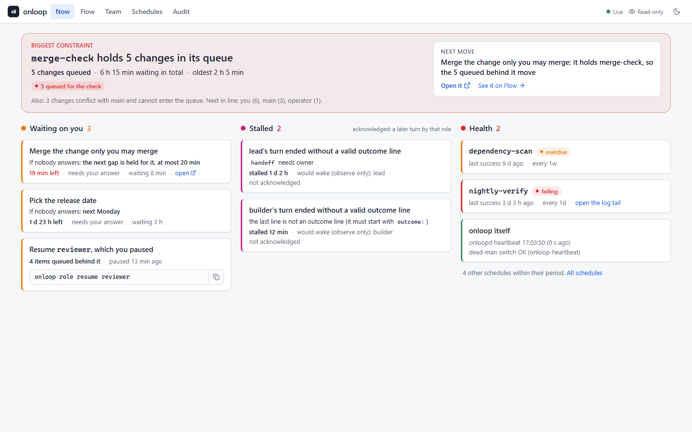

# onloop

onloop is a Python toolkit for running a team of AI coding agents on a GitHub repository with a human **on** the
loop rather than **in** it.

The agents open, review and merge pull requests themselves. The human approves only a short list of reserved
classes: claims, safety widening, authority widening, destructive operations, money and accounts, and anything that
leaves the project. Everything else is decided by the team, stays visible, and can be overturned by the human.

It is built on GitHub's own mechanisms (rulesets, CODEOWNERS, required checks, GitHub Apps, Actions) and adds the
parts GitHub does not have:

- a policy file that says which paths need which approver, from which CODEOWNERS is generated;
- a classifier that computes, from a pull request's own diff, who must approve it;
- a merge gate whose every condition is bound to the exact head commit;
- an audit that re-judges every merge on the main branch afterwards;
- an identity wrapper so agents act as GitHub Apps and never as the human;
- a ledger with pull queues, and a watchdog that reports when the loop has stalled.

Status: 0.3.1 is the latest release, alpha. See [CHANGELOG.md](CHANGELOG.md) and
the roadmap below.



onloopd serves this read-only UI at `http://localhost:8790`: Now, Flow, Team, Schedules and Audit, five views of one
ledger ([docs/ui.md](docs/ui.md)).

## Why human-on-the-loop

A human **in** the loop approves each step. With a team of agents that does not scale: every pull request waits for
one person, the person skims, and approval becomes a ritual. A human **out** of the loop is faster until the first
time the agents widen their own authority, rewrite a published claim or delete something that cannot be restored.

Human-on-the-loop splits the work by consequence:

1. Routine changes are reviewed by an independent reviewer agent and merged by the gate. The human does not see
   them unless they look.
2. A short, named list of reserved classes always needs the human, and the human sees them as a yes-or-no list with a
   recommendation, not as a stream.
3. The rules themselves are in a file the human protects. A pull request that loosens them is classed as authority
   widening automatically.
4. The human can overturn any decision afterwards, because every merge is recorded and audited.

This only works if "the human approved" really means a human did. So agents never hold the human's account, the
reviewer is a separate identity, and every approval is bound to one commit.

## Quickstart

You need Python 3.11 or later, git, and the [GitHub CLI](https://cli.github.com/) (`gh`) for the commands that talk
to GitHub. The offline commands in this section need only Python and git.

Install the release's wheel, which carries the UI (there is no PyPI release; a `git+` install builds from source
without the UI):

```bash
pip install "onloop @ https://github.com/Zhihua-Zhong/onloop/releases/download/v0.3.1/onloop-0.3.1-py3-none-any.whl"      # no clone needed
onloop --version

# or, to work on it:
git clone https://github.com/Zhihua-Zhong/onloop.git && cd onloop
uv venv && uv pip install -e .          # or: python -m venv .venv && pip install -e .
```

Create a repository for the team and generate the starter files:

```bash
mkdir my-team && cd my-team && git init
onloop init --human your-login --reviewer your-reviewer-app --agents your-agents-app
```

`onloop init` writes, and prints each path as it goes:

```
onloop.yaml                          the policy
CODEOWNERS                           generated from the policy
ledger.yaml                          focus, workstreams, decisions, queues, changelog
docs/charter/roles/{lead,operator,reviewer,builder}.md
docs/decisions/TEMPLATE.md           decision record with "decisions by size"
.github/workflows/onloop-gate.yml    the checks the gate requires
.github/workflows/onloop-audit.yml   the main-branch audit
.github/workflows/onloop-preflight.yml   tells the author what the gate would refuse for form
```

It keeps files that already exist unless you pass `--force`. Replace the three placeholder logins in `onloop.yaml`
with real ones if you did not pass them. Then check what you have:

```bash
onloop policy check                  # policy ok: 9 paths, 4 roles
onloop codeowners --check            # CODEOWNERS matches the policy
onloop ledger check                  # ledger ok
```

Ask the classifier who must approve a change. With `--paths` it classifies the paths you name; without it, it reads
`git diff` between two refs:

```bash
onloop classify --paths src/app.py
onloop classify --paths docs/decisions/0001-first.md
onloop classify --base origin/main --head HEAD
```

The first answer is `approvers needed: reviewer`. The second is `human, reviewer`, because `docs/decisions/` is
reserved to the `claims` class in the starter policy.

Prove the checkers still do their job:

```bash
onloop selftest
```

It feeds every checker a case it must catch (a policy loosening, a stale-head approval, a merge by the wrong
identity, a rewritten changelog and so on) and ends with `verdict: every checker still bites`. It needs no network.

### How the gate and the audit run

Commit the generated files and push them. Then:

- **Gate checks.** `.github/workflows/onloop-gate.yml` runs on every pull request. Its job is named `policy`, which
  is the check `required_checks` lists in the starter policy. It validates the policy, the CODEOWNERS file and the
  ledger, and runs `onloop selftest`. It needs no secrets.
- **The merge.** The operator role runs `onloop as-app --identity agents -- onloop gate <number>` from a checkout
  whose remote is the repository, so the merge is made by the agents App (see below). The gate prints every reason it refuses, or merges with
  `--match-head-commit`. `--dry-run` decides without merging.
- **The audit.** `.github/workflows/onloop-audit.yml` runs on every push to `main` and once a day. It runs
  `onloop audit`, which re-judges every merge on `main` against the policy as it read at that merge, and fails the
  workflow on any merge the policy would not have allowed.

The starter workflows install onloop from the tagged GitHub release; pass `--install-spec` to `onloop init` to use a
fork or another tag.

### Agent identity

Create two GitHub Apps, one for the reviewer and one for the agents team, install them on the repository, and fill
the `apps:` block of `onloop.yaml` (see [docs/configuration.md](docs/configuration.md)). Keep each private key
outside every git work tree and point an environment variable at it. Then:

```bash
pip install "onloop[app] @ https://github.com/Zhihua-Zhong/onloop/releases/download/v0.3.1/onloop-0.3.1-py3-none-any.whl"   # adds cryptography, needed only for signing
onloop as-app --identity agents   -- git push origin my-branch
onloop as-app --identity agents   -- gh pr create --title "[builder] Fix the parser" --body "..."
onloop as-app --identity reviewer -- gh pr review 12 --approve --body-file verdict.md
```

## Watching the team: onloopd

onloopd is the resident service ([decision 0008](docs/decisions/0008-resident-service-and-dead-man-switch.md)). It
binds the loopback address only (port 8790 by default), reads GitHub into the overlay ledger by GETs, takes the role
sessions' hooks and the scheduled jobs' results, and on every tick detects what is stuck: a turn without a valid
outcome line, a `continue` whose waker is dead, a scheduled job that failed or did not run, a merge whose post-merge
step has no evidence. In this release it **observes only**: it records what it would do, and wakes nobody.

```bash
onloop daemon run                                   # the service, in the foreground
onloop ingest github --once --repo owner/name       # one read of a repository into the ledger, by hand
onloop report observe --since 2026-11-16            # what it would have done, next to what happened
onloop kpi weekly                                   # asks to the human and messages to the coordinator, per week
onloop preflight 12                                 # a pull request's form problems and the slots it needs
onloop slot need --paths db/migrate/001.sql
```

See [docs/configuration.md](docs/configuration.md) for `onloopd.yaml` and every command, and
[docs/automation.md](docs/automation.md) for the slots and the `slots:` and `automation:` policy blocks.

## Concepts in one screen

**Policy.** `onloop.yaml` maps paths to an owner role, a review tier and, optionally, a reserved class. It also
names three different GitHub accounts: the `human`, the `reviewer` App and the `agents` App. A path is either an
exact file or a directory ending in `/`; the longest match wins.

**Reserved classes and approvers.** Six classes always exist: `claims`, `safety_widening`, `authority_widening`,
`destructive`, `money_accounts` and `leaves_project`. Each names its approver, `human` or `reviewer`, and all six
default to `human`. You can add your own. A change always needs the reviewer; it needs the human as well when any
touched path is in a class the human approves.

**Classification.** `onloop classify` computes the reserved classes touched, the approvers required, the highest
review tier and the owning roles, from `git diff base...head`, not from the file list a host reports. Renames are
treated as a delete plus an add, so moving a file out of a reserved path counts as touching it. When the change
touches `onloop.yaml`, the classifier also compares the policy on the base with the policy on the head. Any
relaxation (a path loses its reservation, a class moves from human to reviewer, an identity changes, a required
check disappears) is classed as authority widening and needs the human, whatever the new policy says about itself. A
head policy that cannot be read is treated the same way.

**The merge gate.** `onloop gate N` merges only if all of these hold on the exact head commit: the pull request is
open, not a draft, and aimed at the base branch; the reviewer App approved this head and nobody has a standing
request for changes; the human approved this head when the classification asks for it; every required check is green
on this head (every run of a check, not just the last); the authoring role (a `[role]` title prefix, else a `Role:` trailer) owns every path changed, or the
pull request carries a `Cross-owner:` line; and the project's own checks pass. A review or check on any other commit
counts for nothing. It merges with `--match-head-commit`, so a push after the decision makes GitHub refuse. If a
post-merge check fails, it reverts the merge.

**The audit.** `onloop audit` walks the first-parent history of `main` and accepts only a gate merge that the policy
of its own time would have allowed, a merge by the human, or a gate revert. A direct push, a merge no pull request
explains, a merge of something other than the head, or a merge with missing evidence is an alarm.

**Agent identity.** `onloop as-app` signs a short-lived token for a GitHub App installation, runs one `git` or `gh`
command with it, and discards it. Nothing is written to disk. The reviewer identity may only post reviews and
comments.

**Ledger and queues.** `ledger.yaml` holds the focus, the workstreams, the decisions waiting for the human, one queue
per role, and an append-only changelog. Each role pulls its next item from its own queue (`onloop ledger next`).
An empty queue is reported, which is what stops a team of agents from stalling while it waits to be told what to do.

**Watchdog.** `onloop watchdog` reports items stuck in one state past a limit, roles whose queue is empty, and open
pull requests waiting too long for a reviewer verdict.

More detail is in [docs/concepts.md](docs/concepts.md).

## How it relates to rulesets and CODEOWNERS

onloop does not replace GitHub's own controls. It relies on them and fills in what they do not express.

- **CODEOWNERS** is generated from the policy and checked against it (`onloop codeowners --check`), so the two
  cannot drift. GitHub uses it to request reviews. onloop does not depend on GitHub enforcing it; the gate computes
  its own approvals.
- **Rulesets and branch protection** are still where you require the `policy` check, block direct pushes to `main`,
  require pull requests, and restrict who may bypass. onloop's audit detects what gets through anyway, but it does not
  stop it. Configure the ruleset.
- **Required checks** are listed in `required_checks`. The gate refuses to merge unless each is green on the head.
- **What GitHub lacks.** GitHub can require "an approving review from a code owner". It cannot say that one class of
  change needs a human account and another a reviewer App, bind that to the exact head, notice that a pull request
  weakens the rules that govern it, tell a human review from an agent's review made under the human's credentials, or
  re-check every merge after the fact. onloop does those.

Recommended repository settings: allow merge commits only (the gate merges with `--merge` and the audit expects a
two-parent merge), require pull requests, "Require review from Code Owners" and the `policy` check on `main`, and do not let the agents App
bypass. Code-owner review is what stops the agents App from merging a reserved path by a route that does not pass the
gate (see the limits in [docs/security-model.md](docs/security-model.md)).

## Documentation

- [docs/index.md](docs/index.md): table of contents
- [docs/concepts.md](docs/concepts.md): how the pieces fit
- [docs/architecture.md](docs/architecture.md): the package's layers, supported surface, extension points and state
- [docs/configuration.md](docs/configuration.md): every field of `onloop.yaml` and `ledger.yaml`
- [docs/automation.md](docs/automation.md): slots, pre-flight, the KPIs, and the `slots:` and `automation:` blocks
- [docs/security-model.md](docs/security-model.md): what is trusted, what is bound, what is not protected
- [docs/faq.md](docs/faq.md)
- [docs/ui.md](docs/ui.md): the read-only UI onloopd serves, and how it is built and tested
- [docs/supervisor.md](docs/supervisor.md): the role table and the governed step runner (`onloop step`)
- [docs/decisions/](docs/decisions/): the decision records
- [examples/minimal/](examples/minimal/): a toy configuration that validates

## Status and roadmap

0.1.0 was the first release; 0.2.0 added the dashboard (`onloop dashboard`) and the demo site (`onloop demo`).
Everything described above exists and has a self-test.

0.3.0 (2026-11-11) adds:

- **The governed step runner.** `onloop step --config supervisor.yaml --role R --pr N` runs one role step for one pull
  request, from a CI job: it reads whether the step is due from the role's triggers (by GETs), then runs one bounded
  headless `claude -p` call with the role's tools under `dontAsk`, a wall budget and a silence limit enforced by the
  step's own pid, and writes the result to a file so the step needs no write tool. Dry run unless `--live`, which
  refuses a metered API key and an unlogged CLI. `onloop supervise --once` prints every step that would start now;
  `onloop digest` and `onloop attention` cover the person's asks. See [docs/supervisor.md](docs/supervisor.md) and
  [decision 0003](docs/decisions/0003-roles-run-as-ci-jobs.md).
- **onloopd**, observe-only: the overlay ledger, the hook receiver, the GitHub ingest, the detectors, the
  observe-only report and the weekly KPIs. The act-mode loop (`onloop run`, `intake`, `acceptance`, `handover`) is
  removed.
- **The UI**, served by onloopd: five read-only views of the ledger (Now, Flow, Team, Schedules and Audit). It
  replaces the dashboard, the demo site, the workbench and the work-graph panel, which are removed
  ([docs/ui.md](docs/ui.md), [decision 0009](docs/decisions/0009-one-read-only-ui.md)).

Where it goes next ([decision 0004](docs/decisions/0004-onloop-hosts-the-conversation.md)): onloop becomes the
operations layer for a team of AI agents, a loop owner that runs outside any session, hosts the role sessions itself
(`claude -p --resume`), holds goals and a clock, delivers events into the sessions, tracks who waits on whom, and
watches results.

- **0.3.0 observes:** scheduled-job results, the constraint view, handoffs nobody owns, system time, checks that fail
  closed, and a report of what onloop would have done against what happened.
- **0.4.0 acts:** delivery into sessions, reserved gaps, a safe stop, and no clutter and no expiry, with onloop's own
  dead-man switch.
- Not yet: act mode in a real project, and a PyPI release.

## Licence

Apache License 2.0. See [LICENSE](LICENSE) and [NOTICE](NOTICE). Security reports: [SECURITY.md](SECURITY.md).
Contributions: [CONTRIBUTING.md](CONTRIBUTING.md).
