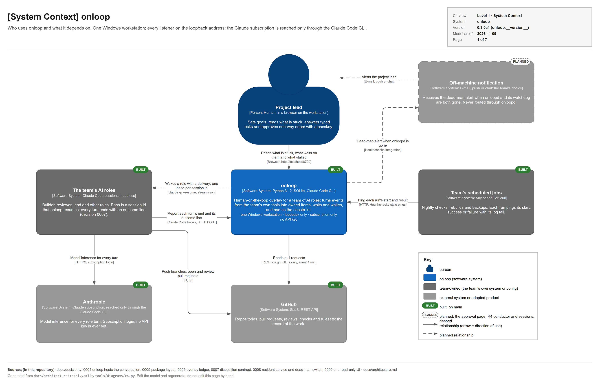
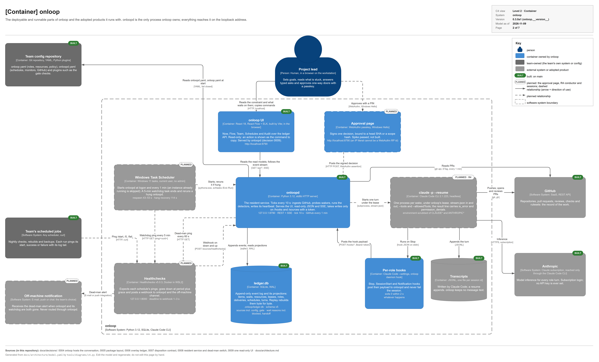
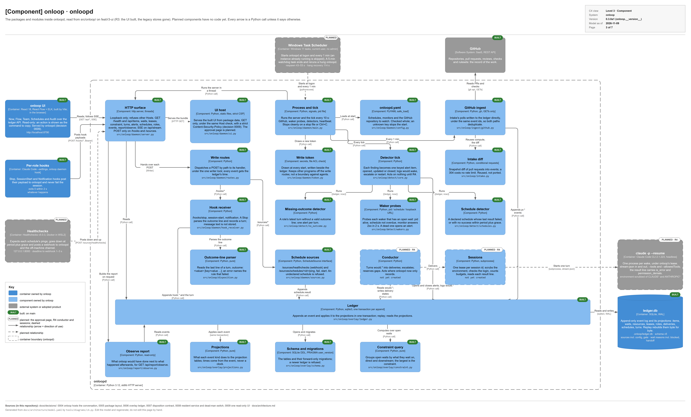
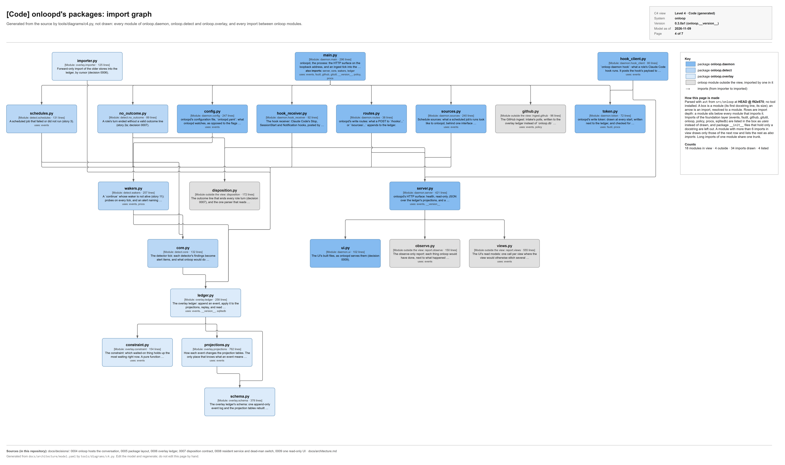
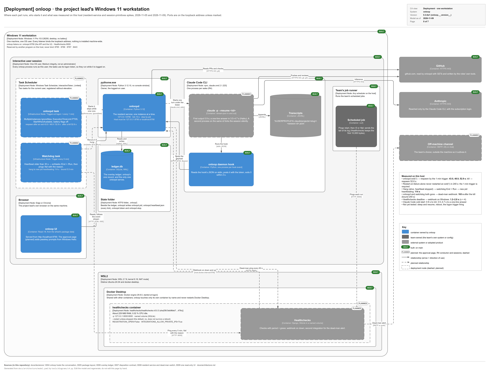
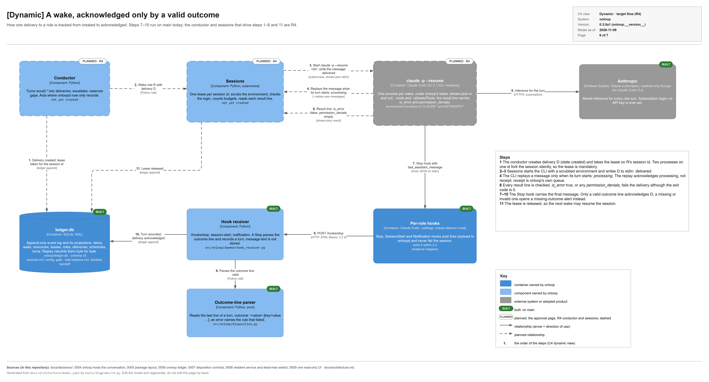
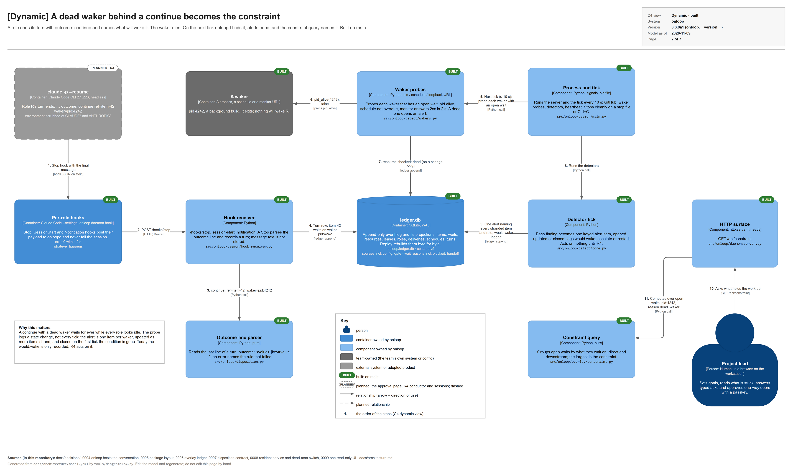

# Architecture

This page describes the code as it is: the package's layers and the direction in which they may depend on each
other, the surface onloop supports for its users against what is internal, the extension points, and where state
lives. Where onloop is going is in [decision 0004](decisions/0004-onloop-hosts-the-conversation.md); the earlier target
picture is [design/architecture.md](design/architecture.md).

## Diagrams

onloop's architecture is drawn as a [C4](https://c4model.com) set, generated from one model file,
[architecture/model.yaml](architecture/model.yaml), into one draw.io file,
[architecture/onloop-c4.drawio](architecture/onloop-c4.drawio), with one page per view. Every element carries its
C4 type, technology, responsibility, owner and status: **built** (on `main`), **in progress** (on a branch, not yet
on `main`; none at present) or **planned** (the R3 UI, the R4 conductor and sessions). The pages are in C4 order.

**Level 1, System Context.** Who uses onloop and what it depends on: the project lead, the team's AI roles (Claude
Code sessions that onloop resumes), the team's scheduled jobs, GitHub, the Claude subscription (reached only through
the Claude Code CLI) and the off-machine channel that carries the dead-man alert.



**Level 2, Container.** The runnable parts. onloopd (Python 3.12, loopback port 8790, REST and SSE) is the only
process onloop owns; it writes `ledger.db` and imports the read-only legacy stores. Around it are the planned UI and
approval page, the `claude -p --resume` processes (one per wake), the per-role hooks, the transcripts, Healthchecks in
Docker on WSL2 (port 8000), Windows Task Scheduler and the team's config repository.



**Level 3, Component (onloopd).** The modules inside onloopd, read from `src/onloop/` on `main`: the HTTP surface
and the process tick, the write routes, token, hook receiver, schedule sources, outcome-line parser, GitHub ingest,
detectors and observe report, the overlay ledger with its projections, schema and constraint query (all built), and
the planned UI host, conductor and sessions. Each box names its code path.



**Level 4, Code.** Not drawn by hand: `tools/diagrams/c4.py` parses the source with `ast` and draws every module of
`onloop.daemon`, `onloop.detect` and `onloop.overlay`, with every import between onloop modules as an arrow. Imports
of the foundation layer are listed inside each box instead of drawn. Edges are orthogonal: a module's imports of the next row leave it as one comb, long imports of one module share one trunk, and a hub with more than six imports in view (`main.py`) lists its longer imports in its box. The page names the git ref it was read from.



**Deployment.** The project lead's workstation: the interactive user session with its two scheduled tasks,
`pythonw.exe` running onloopd, the state folder, the Claude Code CLI, the browser and the team's job runner; WSL2,
Docker Desktop and the Healthchecks container with its run flags; GitHub and Anthropic outside. The measured
recovery times (respawn 43–53 s, hang recovery 114 s, dead-man alert at 163 s, webhook 1–3 s after a deadline) are
on the elements, and the ports reserved by another program on this host are listed on the host.



**Dynamic, a wake.** How one delivery goes from created to acknowledged: delivered when written to stdin,
processing when the CLI replays it, then the result line's checks (`is_error`, `permission_denials`), the Stop hook,
a valid outcome line (decision 0007), and the lease released. Steps 7 to 10 run on `main`; the rest is R4.



**Dynamic, a dead waker.** A role ends with `outcome: continue` naming a waker; the waker dies; on the next tick
the waker probe logs it dead, the detector opens one alert, and the constraint query names the dead waker as what
holds the work up.



To change a diagram, edit the model and regenerate; never edit the `.drawio` file or the PNGs by hand.

```bash
python tools/diagrams/c4.py --check
```

```bash
python tools/diagrams/c4.py --export --drawio "<path to draw.io.exe>"
```

`--check` only validates: it fails when a view names an unknown element, when a relationship or a dynamic step has
an end outside its view, or when an element misses a required field. Without `--export` the script writes the
`.drawio` file only. `--export` also renders each page with draw.io desktop
(`-x -f png -s 2 -b 20 -p <page> -o <png> <drawio>`); the executable comes from `--drawio` or `$DRAWIO_EXE`. The code
page reads the git ref named in the model (`views[].code.ref`); `--code-ref` overrides it, and a ref of `null` reads
the work tree. Facts that live in the code, such as onloopd's port and the ledger's schema version, are parameters (`params` in the model, written `${name}` in the text): the model records the value the pages show and where the code defines it, the script prints a note when the work tree's code differs, and `--params-from-code` shows the code's value instead. `tests/test_c4_diagrams.py` checks the model on every test run.

## Layers

`onloop` is one Python package, in `src/onloop/` ([decision 0005](decisions/0005-package-layout.md)). Its modules
fall into five layers. A module may import from its own layer or from a
layer below it, never from a layer above. `tests/test_architecture.py` enforces this on every module, so a new import
that points upwards fails the build.

| Layer | Modules | What it holds |
|---|---|---|
| 0. Foundation | `events`, `policy`, `identity`, `github`, `gitutil`, `procs`, `fsutil`, `sqlitedb`, `asapp`, `watchdog`, `testing` | The event vocabulary and the one timestamp format; the policy file's model; agent identities; the only clients for GitHub (`gh`) and git; child processes; atomic file writes; the SQLite plumbing; the fakes of the GitHub and git clients |
| 1. State and rules | `overlay/`, `ledger`, `classify`, `codeowners`, `gate`, `audit`, `verdicts`, `anchor`, `hooks`, `init`, `liveness`, `disposition` | The overlay ledger (one event log, its projections, replay, the one-shot import of the legacy stores, the constraint query); the people's work queue (`ledger.yaml`); the classifier, the merge gate and the audit; who counts as the reviewer; role anchors and hooks; the starter files; the session liveness recorder; the turn outcome line (decision 0007) |
| 2. Ingest, detection and measures | `intake`, `ingest/`, `detect/`, `report/`, `slots`, `preflight`, `kpi` | The pure diff of GitHub snapshots into events, and its ingest into the overlay ledger; the detectors (what is stuck, and what onloop would do about it); the observe-only report, the weekly counters and the UI's read models (`report/views.py`); the slots (scarce resources); pre-flight; what is measured from the log |
| 3. Features | `daemon/`, `supervisor/` | onloopd, the resident service (its HTTP surface, the UI it serves, and its ingest tick); the role table and the governed step runner, with its node model and GitHub-issues mapping |
| 4. Command line | `cli` | `onloop`: parses arguments and calls one function per command |

Two rules hold inside the layers:

- **One client per outside system.** onloop's own GitHub reads and writes go through `github.py`, and the gate's and
  intake's git work through `gitutil.py`. A process onloop starts and must be able to stop (a role step, a configured
  writer or `after_result` command, a project check) is started through `procs.py`, which knows how to stop its whole
  tree by its pid. Two small git calls stay outside `gitutil.py`: the audit's start (`cli._since`) and the check that a
  key file is outside a work tree (`asapp`).
- **One place per rule.** The reviewer's verdict is read only in `verdicts.py`; refusal codes are made only in
  `gate.py`; timestamps are made and checked only in `events.py`. Tests fail if another module reads `review.submitted`
  events directly.

The layer-0 module `testing` holds fakes; besides the tests, `audit` uses it to run the real gate over prepared facts.

The UI is not a Python module: it is the `web/` app (React, React Flow and ELK), built at release time into
`src/onloop/ui/` and served by onloopd ([ui.md](ui.md), [decision 0009](decisions/0009-one-read-only-ui.md)).

## Supported surface and internals

What a user may rely on, and what changes only with a changelog entry under **Changed** or **Removed**:

- **The commands**: every `onloop` command, its flags and its exit codes, as listed in
  [configuration.md](configuration.md#command-reference). Output meant for a program (`--json`, `last-step.json`,
  the gate's refusal codes such as `P001`) is part of it.
- **The files a user writes**: `onloop.yaml`, `ledger.yaml` (the people's work queue), `supervisor.yaml` and
  `onloopd.yaml`. Every key is checked, and an unknown key is an error.
- **The files onloop writes for others to read**: the generated `CODEOWNERS`, the starter workflows from `onloop init`,
  and the result files of role steps.
- **onloopd's HTTP API** on the loopback address: `/health` and the read-only `/api/items`, `/api/waits`,
  `/api/leases`, `/api/constraint`, `/api/turns`, `/api/alerts`, `/api/schedules`, `/api/roles`,
  `/api/report/observe`, `/api/now`, `/api/flow`, `/api/events` (with its filters) and `/api/stream` (Server-Sent
  Events). Fields may be added; a field's meaning does not change without a changelog entry. The UI's routes (`/`,
  `/assets/...`) are not an API.
- **The extension points** below.

Everything else is internal: the Python modules and their functions, the SQLite schemas (migrated forward
automatically; a database from a newer onloop is refused), the event payloads, and the state directory's file
formats. Import `onloop` from your own code only through the extension points; anything else may change in any
release before 1.0.

## Extension points

| Point | How | What it may do |
|---|---|---|
| A project's gate checks | The entry-point group `onloop.checks`: a callable `(facts, policy, classification) -> list[str]` | Each returned sentence is a reason for the gate to refuse; an exception is also a refusal. See [configuration.md](configuration.md#extension-points) |
| A project's commands around a merge | `checks` and `post_merge_checks` in `onloop.yaml`, read from the base branch, never from the head | A failing check refuses the merge; a failing post-merge check reverts it |
| A project's locks | The `slots:` block in `onloop.yaml`: each slot's paths, capacity, approver and waits | Who may hold a scarce resource, and for how long. See [automation.md](automation.md) |
| A project's roles | The role list in `onloop.yaml` and `ledger.yaml`, and the role table in `supervisor.yaml` | Each role's owners, queues, tools, budget, triggers and prompt. See [supervisor.md](supervisor.md) |
| Acting on a step's result | A role's `after_result` command | The one write a read-only step needs, from its structured result |
| Notices | `notifier` in `supervisor.yaml`: `log`, `webhook`, `desktop` or `stub` | Where the attention rules' notices go |

Decision 0004 makes the gate, the locks and the role list plugins configured in the project's own repository. Today
only the gate checks are a Python plugin; the locks and the roles are configuration.

## Where state lives

| State | Where | Written by | Notes |
|---|---|---|---|
| The truth about the work | GitHub: pull requests, reviews, checks, issues, labels, comments | people and agents | onloop's records of it are a cache that intake can rebuild |
| The rules | `onloop.yaml`, `ledger.yaml`, `CODEOWNERS` in the project's repository | people, through pull requests | the gate reads the policy from the base branch |
| The overlay ledger | `.onloop/ledger.db` (or `$ONLOOP_LEDGER`), SQLite in WAL mode | onloopd (its ingest tick and its write routes), `onloop gate` (its decisions), `onloop slot`, `onloop role`, `onloop item`, `onloop overlay import` | the only record onloopd reads: an append-only event log and its projections (items, waits, resources, leases, roles, deliveries to roles, schedules), which `onloop overlay replay` rebuilds byte for byte ([decision 0006](decisions/0006-overlay-ledger.md)) |
| onloopd's own files | next to the ledger: `onloopd.pid`, `onloopd.heartbeat.json`, `onloopd.stop` (a stop request) | `onloop daemon run` and `stop` | the pid file is removed at a clean stop |
| The legacy event store | `.onloop/onloop.db` from an older install | nothing any more (the gate writes its decisions to the ledger) | read once by `onloop overlay import --store`, the upgrade path ([decision 0006](decisions/0006-overlay-ledger.md)'s checklist is closed) |
| The legacy work graph | the `store` file an older install's work graph used (default `workgraph.db`) | nothing any more | read once by `onloop overlay import --workgraph`, the upgrade path |
| A role step | `--state DIR`: `last-step.json` and the step's output; `--out DIR`: the result file | `onloop step` | a CI job uploads them as artifacts |
| The planner and the attention rules | the `state_dir` of `supervisor.yaml` (default `.onloop/supervisor`): `steps.jsonl`, `snapshot.json`, `heartbeat.json`, `alerts.jsonl` | `onloop attention --notify` writes `alerts.jsonl`; nothing writes the other three today | see [supervisor.md](supervisor.md#records) |
| Session liveness | `--dir` (default `$ONLOOP_LIVENESS_DIR`, else `./liveness`): one file per session | `onloop liveness record`, from hooks | never holds prompt text |
| The UI's built files | `src/onloop/ui/` in a checkout, `onloop/ui/` in an installed package | `npm run build` in `web/`, at release time | never committed; the wheel carries them, and CI fails a wheel without them |

No state lives in an agent's session: what a session needs to resume is in the files and on GitHub above.

*The overlay ledger* (`ledger.db`, onloop's own record) and *the people's work queue* (`ledger.yaml`, which the
`onloop ledger` commands read) are different things. Where both appear, the docs use these two names.
