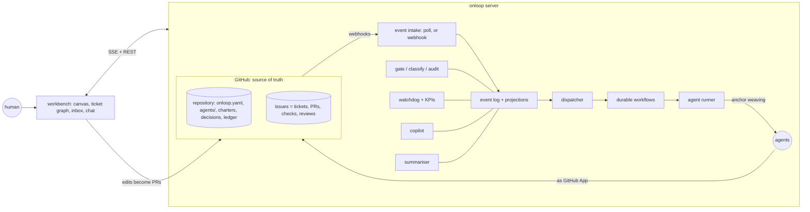

# onloop: target architecture

*Status: proposal, 2026-10-11, revised the same day after interviewing the six agent roles of the first team that
ran this way (section 9). Written before any of it is built, so the parts fit one design. Releases 0.1 and 0.2 are
the first two steps of it; nothing below is implemented unless the roadmap says so.*

## 1. What onloop becomes

onloop today is a command-line toolkit: a policy file, a classifier, a gate, an audit, a ledger. The target is a
**workbench for running a team of AI agents with a human on the loop**:

- the team is drawn on a canvas, as agents and the connections between them;
- the work is a graph of tickets and actions, from strategy down to single commits, and it can be zoomed between
  those levels;
- every agent carries its role, its KPIs and the project's current focus into every turn, so it cannot drift into
  detail;
- the loop runs itself on events, and the human sees only the decisions that are theirs.

One rule holds the design together:

> **The repository is the source of truth; the workbench is a view and an editor of it.** Every change made on the
> canvas becomes a pull request and goes through the same gate as any other change. The UI is just another author.

This rule comes from experience. When the slides, the map and the database each kept their own copy of a published
figure, they disagreed in public. A canvas with its own database would become one more copy. Because canvas edits
are pull requests, giving an agent more authority from the UI is classed as authority widening and goes to the
human, exactly as it does from a text editor.

## 2. Concepts

| Concept | What it is | Stored as |
|---|---|---|
| **Project** | One repository under onloop | `onloop.yaml` |
| **Agent** | One working role instance: name, role, model, runtime, charter, tools, owned paths, KPIs, WIP limit, budget | `agents/<name>.yaml` + `docs/charter/roles/<role>.md` |
| **Edge** | A directed or two-way relation between agents: `hands_off_to`, `reviewed_by`, `escalates_to`, `informs` | in the agent files |
| **Anchor** | Text woven into every agent turn: the north star, the current focus, the agent's KPIs, the hard stops | `ledger.yaml` (focus) + agent files (KPIs) |
| **Ticket** | A unit of intent, written as a spec: goal, acceptance criteria, owner, parent, children, status | GitHub Issue (with sub-issues and dependencies) |
| **Action** | Something that happened on a ticket: a PR opened, a verdict, a merge, a ruling, a run | event log (append-only) |
| **Suggestion** | A proposed next action after an action, with who picks it: the agent, or the human | event log |
| **Decision** | A ruling, sized: the human's six reserved classes, or the lead's (overturnable) | `docs/decisions/` |
| **Claim** | A published number with its definition: value, denominator, basis and the run that produced it | claims registry (`claims.json`), single source |
| **Slot** | A scarce shared resource an agent must hold to act: the database, the host, the CI runner, the gate. A grant carries its conditions and exact commands | lease table |
| **Deliverable** | Something the human can open: a link, a readiness checklist (owner, state, fallback) and when someone last looked at it | `deliverables.yaml` |
| **Criteria** | The pass/fail conditions of a measurement, written and timestamped before the run they judge | `criteria/<run>.yaml` |

The event log is the project's memory. Tickets, actions and suggestions linked together are the project's
**domain knowledge**: why something was done, what was tried, who decided.

## 3. Architecture

**Flow of one event.** onloop learns of a GitHub event (for example, a PR receives a review). Because the server is
local, GitHub cannot call it, so 0.3 polls the events API with conditional requests; a webhook through a tunnel is
an option the human may turn on later. The event is appended to the log
and the projections update. The dispatcher finds which agent the event concerns, following the edges. It starts a
durable workflow, which acquires any slot it needs and runs the agent with its anchors woven in. The agent acts on
GitHub as its App, and that produces the next event. Nobody polls and nobody waits idle: an agent exists only while
it has work.

## 4. The ten capabilities

### 4.1 Agent canvas: create, edit, delete, inspect by drag and click

- Drag a role from a palette onto the canvas to create an agent. Click it to edit its charter, model, tools, owned
  paths, KPIs and budget in a side panel.
- Delete or rename it in place. Hover to see its state: idle, working on which ticket, its queue, and its cost today.
- Saving opens a pull request with the YAML diff. The classifier shows on the canvas who must approve it: a new tool
  or a wider path is authority widening and goes to the human.

### 4.2 Edges: dependencies between agents

- Draw a line from one agent to another and pick its kind. `hands_off_to` routes finished work to the next agent's
  queue. `reviewed_by` makes the second agent the first one's reviewer. `escalates_to` names who gets stuck items.
  `informs` copies events.
- **Edges are authority.** Adding, removing or redirecting a `reviewed_by` or `escalates_to` edge is judged by the
  same base-versus-head loosening rule as any policy change, so weakening review goes to the human whatever file it
  lives in.
- An edge can be one-way or two-way. Edges are also permissions: an agent can message only the agents it is
  connected to. That makes the communication graph explicit, and auditable.
- The canvas checks the graph as you draw. It flags a reviewer that shares the author's App identity (independence is
  checked by identity, not by name), a reviewer that reviews itself, a cycle of `escalates_to`, and an
  agent with no path to a human.

### 4.3 Roles, KPIs and anchor weaving

This is the answer to "the lead sinks into detail and forgets the big picture". The fix is structural, not a
reminder: the project's direction is **woven into every turn**, the way aspect-oriented programming weaves a
cross-cutting concern into every method call.

- **Anchors** are composed from the ledger and the agent file:
  1. the north star and the current focus, in priority order;
  2. this agent's KPIs, three to five, each with a target;
  3. the hard stops (the human's reserved classes, destructive operations);
  4. the question "Does this serve the focus? Is it mine, or another role's?"
- **Join points**, where anchors are woven in:
  - session start: the full anchor;
  - every incoming message: a short anchor of at most 150 tokens, **on for coordinating agents** (the lead, the
    operator), which are the ones that drift, and off by default for workers, to save tokens;
  - before a write or merge tool call: the hard stops;
  - before ending a turn: "Does every role you lead have a next item?"
- For interactive sessions the weaving is done with the agent runtime's hooks. For headless runs the runner adds it.
  The anchor is generated from files, never typed into a prompt, so it cannot go stale.
- **KPIs are measured, not declared.** Each KPI has a query over the event log. Examples:
  - PR lead time;
  - idle time with work waiting;
  - reverts;
  - share of PRs that are process rather than product;
  - share of turns on a focus ticket.
- **Not a KPI: review rounds per PR.** It rewards rubber-stamping.
- **The drift detector** (from 0.5). When an agent's share of work linked to a focus ticket falls below its threshold, its next
  anchor says so in one line, and the lead sees it on the canvas.

Evidence from the first team that ran this way: in one month, 34% of merged PRs were team process and 1% were
visible product, and nobody saw it until it was measured. After that, a short anchor injected into every turn kept
the lead agent on the deliverables.

### 4.4 Roadmap: summarised and generated

- The roadmap is a projection of the ticket graph: strategic tickets with their rolled-up status, progress, blockers
  and dates.
- A summariser writes the prose: what moved this week, what is at risk, what needs the human. It writes from the
  graph and the event log, and every sentence links to its evidence.
- A generated roadmap is a **claim**. It is proposed as a PR and becomes "the roadmap" only when the human approves
  it, so a model never rewrites the plan silently.

### 4.5 Project import

`onloop import` starts from an existing repository:

- it reads the issues, labels, milestones, PRs, CODEOWNERS, branch rules and CI;
- it proposes roles from the code structure and the history of who touched what;
- it drafts a starter `onloop.yaml`, agents, charters and a ticket graph.

Everything arrives as one pull request that the human reviews. Linear and Jira importers come later, behind the
same interface.

### 4.6 Copilot: AI advice on the orchestration, built in

- A chat pane can read the whole graph: agents, edges, tickets, events and KPIs. Ask it things like "why is the
  review queue growing?", "who should own the new export job?" or "where are we idle?".
- It answers with evidence links. When it proposes a change ("add a second reviewer", "move dbt/ to the platform
  agent"), the change appears on the canvas as a draft and is applied as a PR.
- It has its own App identity and read-only rights. It cannot merge, approve or message other agents, and it never
  reviews a change it drafted.

### 4.7 Ticket-as-spec graph with semantic zoom

- Every ticket is a box. Open it to see its spec, its acceptance criteria, the actions taken on it and the evidence.
- After each action, onloop offers **suggested next actions**, each tagged with who picks it:
  - **auto**: the agent picks it, because it is routine and not reserved;
  - **agent's choice**: the agent picks among options;
  - **human's choice**: the suggestion touches a reserved class.

  The choice that was made, and the ones that were not, are kept in the log. A suggestion labelled auto can never
  approve, merge or dismiss a review; the pull request it produces is classified by its own diff, never by the
  suggestion's label.
- **Semantic zoom.** The graph has four levels:

  | Level | Shows | Typical node |
  |---|---|---|
  | L0 strategy | north star, phases, demos | "Release 1.0 by the end of the quarter" |
  | L1 workstreams | epics and their state | "Data migration" |
  | L2 tickets | specs and owners | "Rehearse the schema change on a copy" |
  | L3 actions | PRs, verdicts, runs, rulings | "Reviewer: merge at 3f2a91c" |

  Zooming out collapses children into their parent. The parent then shows a computed roll-up (counts, status,
  blockers) and a generated summary. **A generated summary never contains a number of its own**; it references
  claims and roll-ups, which carry their evidence. The summary is cached, marked as generated, and shown as stale when a child
  changes after it was written. Zooming in expands it again. This is level-of-detail rendering, the technique maps
  use to go from continents to streets.

### 4.8 The human's inbox

- There is one list of what only the human can do, in three sections:
  - **rulings**: yes/no, sized by class, each with a recommendation;
  - **questions only the human can answer**: outside facts, such as stakeholders or priorities;
  - **decided by the lead this week**: overturnable, generated from the event log with evidence. A ruling that came
    from the human is routed to the human's own record automatically, never typed into the lead's list.
- Everything else stays off the human's screen unless they look.

### 4.9 Slots: scarce resources as first-class objects

- A database window, a host, the gate and a test run are each modelled as a slot with an owner, a queue and a
  timeout.
- An agent asks for a slot and is woken when it gets it. In the first team an operator agent handed slots out by hand,
  and that was the most common reason for waiting.

### 4.10 Trust instruments

These carry over from the first team that ran onloop's ideas, where each one was learned from a failure:

- **Head-bound verdicts.** A verdict or approval counts only for the exact commit it names.
- **Checkers that prove they bite.** Every checker carries a self-test, and onloop refuses to run one whose scope
  has shrunk.
- **Promise watchers.** When an agent says "I'll tell you when X", onloop creates a watcher job for X. A promise
  with no watcher is flagged.
- **Before and after.** A change to the team's process records a baseline metric before and the same metric
  after.
- **Claims registry.** Published figures come from one file, and a page or document that types a number fails CI.
- **Data classification.** The data an agent may reach is declared, and anything outside it is refused at the tool
  layer.

### 4.11 Deliverables page: "what can I open this week?"

The human's first screen (L0) answers one question: what can I open this week, and is it ready? Each deliverable
shows its live link, its readiness checklist (owner, state, fallback) as green or red, and when someone last actually
opened it. Readiness that nobody has looked at for a set time turns amber.

### 4.12 Merge train for windows and stacks

Pull requests that are green one by one can be red together. In the first team, two migrations each passed CI and
broke a test only on the combined main. For anything queued together, a window or a stack, onloop runs CI on the
merged result of each prefix in order. This is the idea behind GitHub's merge queue, and onloop uses the merge queue
where the repository has it. The stack view shows the order, each prefix's result, the heads, the approvals and the
slot for each step.

### 4.13 Evidence drawer and claims with definitions

- Every figure on every screen carries a chip:
  - **measured**: run id, commit, denominator, criteria file;
  - **generated**: fresh or stale.

  A click opens the producing run.
- A claim is checked for its definition, not only its value. A correct-looking number attached to the wrong table
  is the error this catches.
- Criteria are objects too: written and timestamped before the run, then shown as PASS or FAIL next to the numbers.
  A measurement starts by running the baseline twice and reporting determinism.

### 4.14 Directional data firewall

Some projects must keep one class of data away from one part of the system. The first team kept validation data away
from its estimating code. That is not a label: it is a direction, and it is enforced by computing the reachable set
of the protected side (imports plus the producers of its inputs). The firewall's self-test fails when that set
shrinks, because a checker that quietly narrows is worse than one that fails.

### 4.15 Pre-flight and review hygiene

- **Pre-flight at PR open.** It lints the role tag, line endings, the Cross-owner line and the verdict ids before the
  gate ever runs, so nothing is refused for form.
- **A head move is an event.** Every push to a head under review emits a review event that carries the last reviewed
  head. The reviewer's delta pane marks it "merge-only (trees equal)" or "substantive", lists the open must-fixes
  against the new diff, and shows CRLF-only changes as such.
- **A reversal is an event.** The gate reads the latest verdict per head.
- **Cross-owner is quoted by the reviewer**, not waived by the author alone.
- **Computed, not typed.** A verdict's tier and reserved class are computed. Gate and audit read one rule table. Tags
  are set by the tool under the tool's identity.
- **A read never writes state.**

## 5. Technology

| Layer | Choice | Why |
|---|---|---|
| Workbench UI | TypeScript, React, Vite | The mainstream front-end stack |
| Canvas and graph | React Flow (`@xyflow/react`), ELK (`elkjs`) for hierarchical layout | The standard library for node-and-edge editors; ELK does layered layouts and compound nodes |
| UI kit | Tailwind CSS, shadcn/ui, cmdk command palette, Framer Motion | Mainstream, accessible, looks current |
| Client state | TanStack Query, Zustand | Server cache plus small local state |
| Live updates | Server-Sent Events | One-way push, simpler than WebSockets for this |
| Server | Python, FastAPI, Pydantic | The existing core stays Python |
| Event log, leases, dispatcher | SQLite in WAL mode: an append-only event log, a lease table (owner, expiry) for slots, one dispatcher with idempotent handlers keyed by event id | Enough for one host and far less to run; Temporal is the upgrade path when onloop runs on more than one host |
| Event intake | Conditional polling of the GitHub events API; a webhook through a tunnel is optional | The local server cannot be reached by GitHub; exposing it is the human's decision |
| Agent runtime | Claude Agent SDK and headless Claude Code; MCP for tools | Mainstream agent runtime and tool protocol; model routing per agent |
| Identity | GitHub App per role identity; GitHub OAuth for the human | The human's account is never used by an agent |
| Observability | OpenTelemetry with the GenAI conventions; cost per agent per day | Traces per agent run, plus budgets |
| Packaging | `onloop up` binds to the loopback interface only; Docker Compose for a server | Local first; never exposed by default |

## 6. Roadmap

Re-sequenced after the team review: what removed waiting and errors in practice comes first, and the canvas and the
copilot come after the surfaces the human and the reviewers asked for.

| Release | Content | Done when |
|---|---|---|
| 0.1 (released) | Policy, classify, gate, audit, as-app, ledger, watchdog, init | Public, CI green |
| 0.2 | Static dashboard; "How it works" demo on GitHub Pages | Live demo link works |
| 0.3 The loop without waiting | Event intake (polling), event log, idempotent dispatcher; slots with grants, queue, timeout and wake-up, path-scoped (a docs-only change needs no host slot); pre-flight at PR open; auto-ready and auto-gate on a clean verdict; head-move and reversal events; one rule table for gate and audit; reviewer-quoted Cross-owner; anchors at session start and before writes; three KPIs (lead time, idle with work waiting, reverts); handover notes generated from the log | One real project runs a week where no agent waits on a person to hand out a slot, and no PR is refused for form |
| 0.4 Trust surfaces (read-only workbench) | Deliverables page; inbox in three sections; evidence drawer and claims with definitions; criteria objects; reviewer delta pane | The human opens one page on Monday and knows what is ready and what is theirs |
| 0.5 Windows and the graph | Merge train for windows and stacks; ticket graph with semantic zoom (L0 and L2 first); read-only agent canvas; drift detector | A window's PRs are proved together before the first merges |
| 0.6 Editing | Canvas CRUD and edges as PRs (edges as authority); suggested next actions with the picker's identity | An agent added on the canvas is merged through the gate |
| 0.7 Assistance | Copilot (own identity), roadmap summariser (no numbers in prose), project import | A new repository is imported and running in under an hour |
| 1.0 | Hardening, multi-project, documentation, PyPI release | Two outside projects use it |

The first real instance is the project onloop was extracted from: its gate, audit and queues move onto onloop, and
its own checks become plugins.

## 7. What is deliberately not in it

- A second source of truth. The canvas never stores what the repository already says.
- Autonomy beyond the policy. No UI path merges, approves or widens authority outside the gate.
- Silent generated text. Summaries, roadmaps and suggestions are always labelled as generated, and a claim needs
  the human.

## 8. Decided by the human (2026-10-11)

1. **Tickets are GitHub Issues**, using sub-issues for the hierarchy and issue dependencies for "blocked by". onloop
   keeps no ticket store of its own; its event log indexes the issues.
2. **Deployment is local.** `onloop up` runs the server and the workbench on the loopback interface. A hosted
   multi-user server is out of scope until 1.0.
3. **The UI is called the workbench.**

## 9. Team review (2026-10-11)

Six agent roles of the first team answered five questions from their own work, citing pull requests: the operator,
the builder, the reviewer, the validator, the product manager and the platform engineer. Where they agreed:

| Finding | Raised by | Change in this document |
|---|---|---|
| Slots handed out by message were the commonest wait | all six | Slots move to 0.3, with grants that carry conditions and commands, wake-up, and path scoping (4.9, roadmap) |
| A clean verdict took about four messages to reach the gate | operator, PM | Auto-ready and auto-gate on events (roadmap 0.3) |
| Refusals for form, not substance | operator, builder, reviewer | Pre-flight at PR open; tier and reserved computed (4.15) |
| Temporal is too much for one host | builder, validator | SQLite event log with leases; Temporal as the upgrade path (5) |
| A local server cannot receive webhooks | builder | Polling first; a tunnel is the human's decision (3, 5) |
| A per-message anchor costs tokens on every agent | builder | At most 150 tokens, on for coordinating agents only (4.3) |
| Editing the canvas could weaken review | reviewer | Edges are authority; independence by identity; copilot identity; auto suggestions cannot approve (4.2, 4.6, 4.7) |
| A right-looking number on the wrong table | validator | Claims carry definitions; evidence chips; criteria objects (4.13) |
| Two PRs green alone, red together | platform | Merge train for windows (4.12) |
| The human's real question is "what can I open?" | PM | Deliverables page as L0; inbox in three sections (4.8, 4.11) |
| Canvas editing and copilot come before they are needed | builder, validator, PM, platform | Moved to 0.6 and 0.7 (roadmap) |
| "Review rounds per PR" rewards rubber-stamping | reviewer | Removed as a KPI (4.3) |
